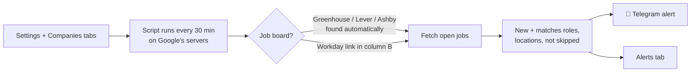

# Career Page Job Alerts (Google Sheet)

**Get a Telegram message within 30 minutes of a new job appearing on your favourite companies' career pages**, often hours or days before it reaches LinkedIn or Naukri.

No n8n, no Docker, no coding. Make a copy of a Google Sheet, fill in a few cells, press Start. It runs on Google's servers, so it keeps working when your computer is off.

👉 **[Make your copy](TEMPLATE_COPY_LINK)**, then follow the **[10-minute setup guide](docs/USER_GUIDE.md)**.

---

## What it does

- **Watches your companies.** Every 30 minutes it checks the career pages of the companies you list. It finds their job boards automatically (Greenhouse, Lever, Ashby), and you can add Workday links.
- **Filters for you.** It keeps only jobs matching **your roles** (in the title, or optionally the description) and **your locations**, and skips titles you don't want.
- **Alerts you on Telegram** through your own private bot, and saves every alert on an **Alerts** tab.
- **Shows its status.** The **Companies** tab shows which companies are watched ✅ and which need a Workday link ❌.
- **No flood of old jobs.** The first check of each company only records what's already posted.

## What users fill in (no code)

| Tab | What to enter |
|---|---|
| **Settings** | Telegram bot token, roles, words to skip, locations, how often to check. The chat ID is filled in automatically |
| **Companies** | One company per row; optional Workday careers link |

Menu **Job Alerts**: *1. Find my Telegram chat ID → 2. Send a test message → 3. Start alerts*, plus *Check now* and *Stop alerts*.

## How it works



Everything is one Google Apps Script file ([`Code.gs`](Code.gs)) attached to the sheet. Each user's copy runs in their own Google account.

## Limits

- **Supported job boards:** Greenhouse, Lever, Ashby and Workday. Companies on SuccessFactors, Taleo, iCIMS or their own sites aren't supported.
- **Google's free quota:** about 90 minutes of script time a day. Checking every 30 minutes suits up to about **150 companies**; for more, set **Check every** to 60.
- **New companies:** about 25 are looked up per run, so a long list takes a few runs to be fully watched.
- **"Unverified app" screen:** users see Google's warning once when they first allow access (*Advanced → Go to … (unsafe)*), because the script lives in their own copy rather than being a published Google app.

## Privacy

- Each user's copy, settings, bot token and alerts stay in **their own** Google account. The person who shared the template can't see them.
- The script only reads public job listings (Greenhouse, Lever, Ashby, Workday) and talks to the Telegram bot the user created.

## For maintainers

```
Code.gs              the whole app (paste into the template's Apps Script)
docs/USER_GUIDE.md   step-by-step guide for users
docs/PUBLISHING.md   how to create, share and update the template
test/test.js         offline tests with fake Google services and job boards: node test/test.js
```

A self-hosted **n8n** version of the same alerts lives in [job-seeker-instant-alerts](https://github.com/anil9bhimineni/job-seeker-instant-alerts).

## License

[MIT](LICENSE)
